# 템플릿 만들기 튜토리얼

빈 카드에서 시작해 챗봇이 매 답변 끝에 붙이는 **상태창 이미지**를 끝까지 만들어 봐요.
이름, 체력 게이지, 목숨 하트, 기분, 지금 상황 글상자가 들어간 480×280 카드예요.
설치가 끝나 관리 화면에 들어갈 수 있는 상태라고 가정해요(설치는 [설치.md](설치.md), 화면 전체 설명은 [관리-화면.md](관리-화면.md)).

다 만들면 이런 그림이 나와요. 왼쪽은 기본값, 오른쪽은 체력이 낮을 때예요.

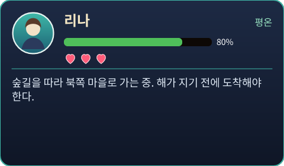 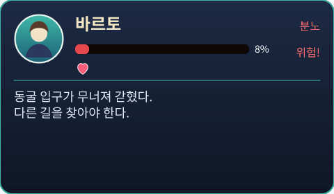

> 화면은 실제 관리 화면(버전 2026-10-22.12)에서 찍었어요. 그림 속 주소의 `localhost:8787`은 내 주소로 바꿔 읽으세요.

---

## 1. 들어가기와 첫 준비

`https://내주소/admin`(관리 화면 주소를 바꿨다면 그 주소)에 들어가 설치할 때 정한 관리 토큰을 넣어요.

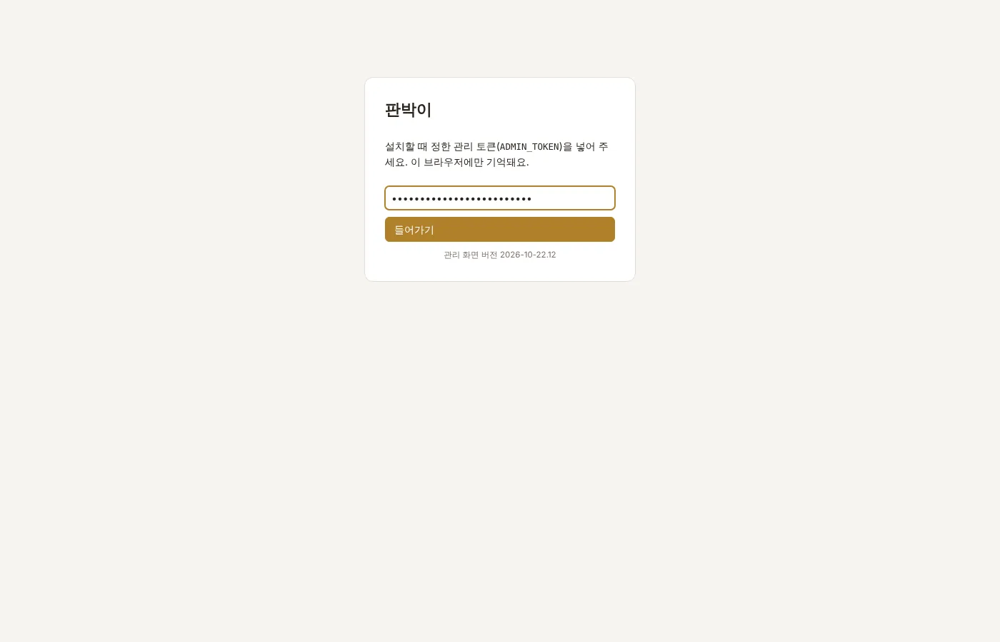

처음 설치했다면 채팅 목록에 **한글 폰트와 샘플 넣기** 버튼이 보여요. 한 번 눌러 두세요. 한글 폰트(Noto Sans KR)와 샘플 템플릿이 들어가요.
한글 폰트가 없으면 이미지의 한글이 네모로 나와요.

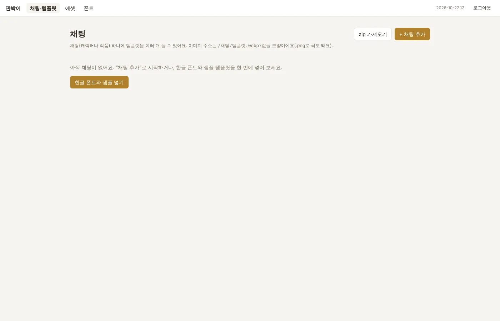

**폰트** 메뉴에서 폰트가 들어갔는지 확인해요. 다른 폰트를 쓰고 싶으면 여기서 올리고 기본 폰트로 정하면 돼요.

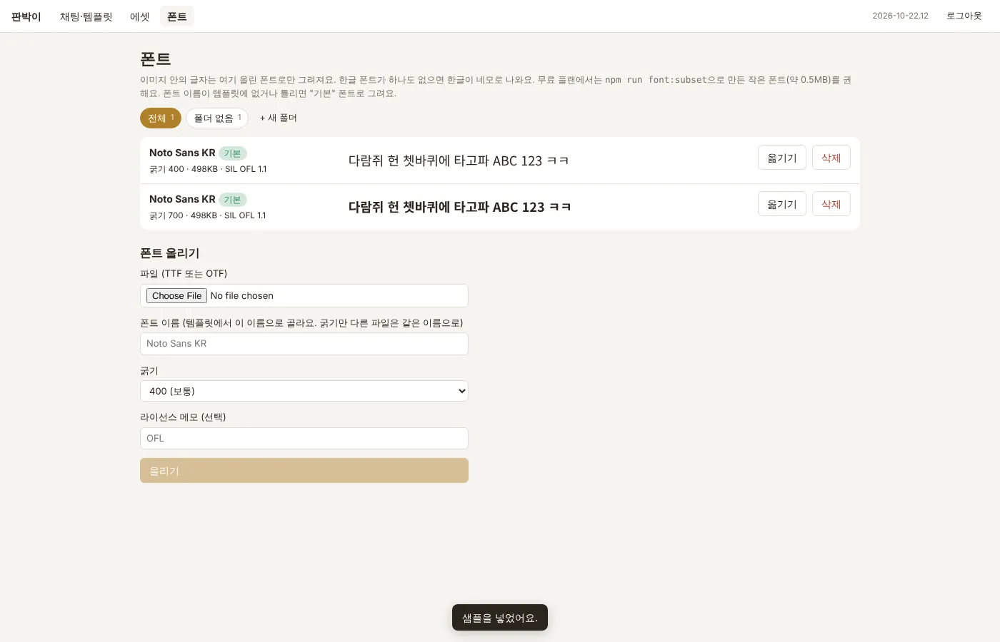

## 2. 그림 파일(에셋) 올리기

템플릿에 쓸 그림을 먼저 올려 둬요. **에셋** 메뉴에서 파일을 끌어다 놓거나 눌러서 골라요. svg, png, webp, jpg를 쓸 수 있어요.
이 예제에서는 초상화 `portrait.svg`와 하트 `heart.svg`를 올렸어요.

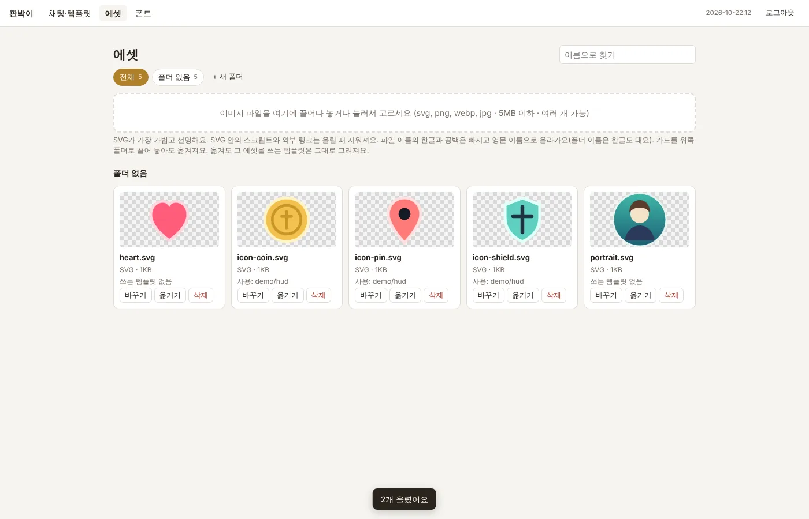

- 파일 이름에 한글이나 공백이 있으면 빠진 이름으로 올라가요. 정상이에요.
- 게임이 여러 개라면 **+ 새 폴더**로 나눠 둘 수 있어요.
- 카드의 **이름 바꾸기**로 이름을 고칠 수 있어요. 그 에셋을 쓰던 템플릿도 새 이름을 따라가요.
- 편집기 왼쪽 아래 칸에 파일을 놓아도 올리면서 바로 배치돼요.

## 3. 채팅과 템플릿 만들기

**채팅·템플릿 → + 채팅 추가**에서 채팅(캐릭터나 작품 하나)을 만들어요. 주소 이름은 이미지 주소에 들어가니 영문 소문자로 짧게 정해요.

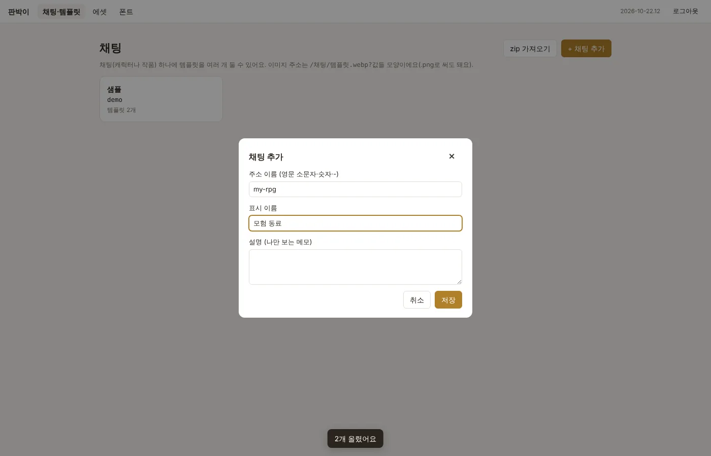

채팅에 들어가 **+ 템플릿 추가**를 누르고, 주소 이름 `status`, 표시 이름 `상태창`, 시작할 모양 **빈 카드**를 골라 **만들기**를 눌러요.
이미지 주소는 `/my-rpg/status.webp`가 돼요.

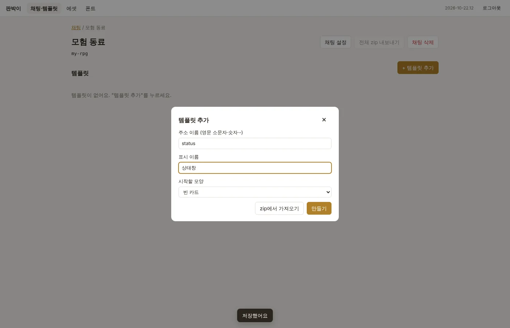

편집기가 열려요. 빈 카드에는 배경 도형 하나와 `{name}` 글자 하나가 들어 있어요.

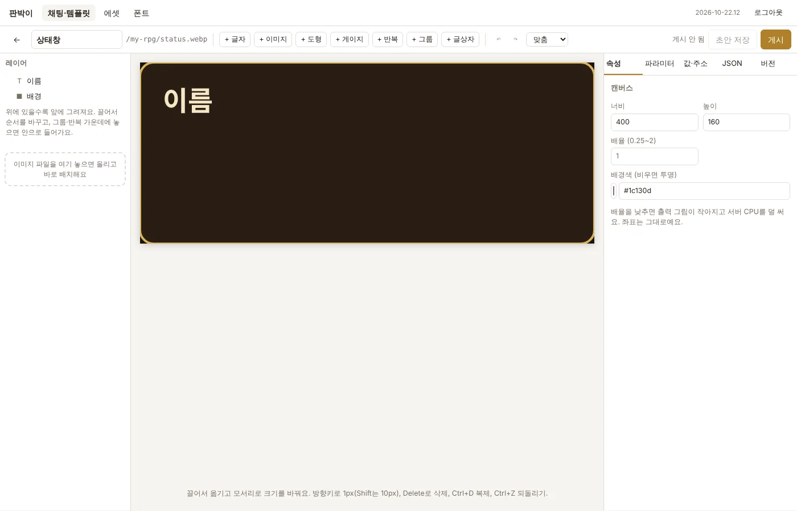

화면은 세 칸이에요.

| 칸 | 하는 일 |
|---|---|
| 왼쪽 **레이어** | 요소 목록. 위에 있을수록 앞에 그려져요. 끌어서 순서를 바꿔요. |
| 가운데 **캔버스** | 누르면 고르고, 끌면 옮기고, 모서리 네모로 크기를 바꿔요. |
| 오른쪽 **탭** | 속성, 파라미터, 값·주소, JSON, 버전. |

## 4. 캔버스 크기와 배경 카드

그림 바깥의 빈 바닥을 누르거나, 레이어 맨 위의 **캔버스** 줄을 누르거나, Esc를 누르면 속성 탭에 **캔버스** 설정이 나와요.
너비 480, 높이 280으로 바꾸고 배경색은 비워 투명하게 둬요(카드 모서리 밖이 투명해져요).

그다음 레이어에서 **배경**을 골라 너비 480, 높이 280, 모서리 둥글기 18로 맞춰요.
채우기의 **그라데이션**을 켜면 두 색을 섞을 수 있어요. 여기서는 `#1d2a44` → `#0f1626`, 테두리 색 `#3fb8a8`로 했어요.

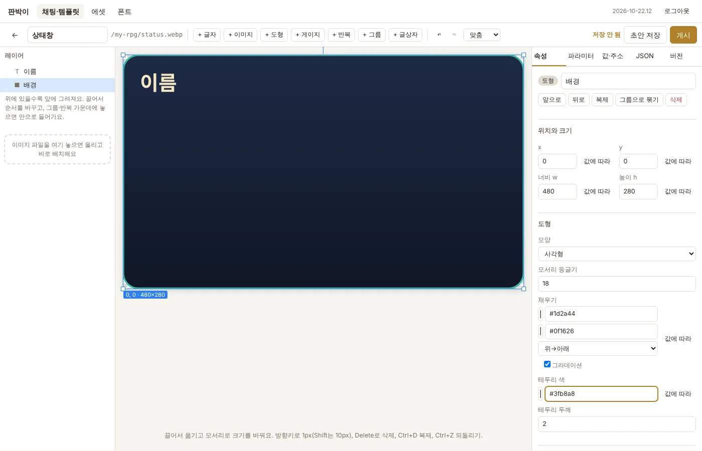

> 숫자 칸은 직접 치는 게 가장 정확해요. 캔버스에서 끌어도 되고, 방향키로 1px(Shift는 10px)씩 옮길 수도 있어요.

## 5. 파라미터 정하기

파라미터는 **챗봇이 주소 뒤에 붙여 보내는 값**이에요. `?hp=72&name=리나`처럼요.
요소를 만들기 전에 먼저 정해 두면 편해요. **파라미터** 탭에서 이름을 넣고 **+ 파라미터**를 누른 뒤 종류를 골라요.

| 이름 | 종류 | 설정 | 설명 |
|---|---|---|---|
| `name` | 글자 | 기본 `리나`, 최대 10자 | 캐릭터 이름 |
| `hp` | 숫자 | 기본 80, 0~999 | 현재 체력 |
| `maxhp` | 숫자 | 기본 100, 0~999 | 최대 체력 |
| `lives` | 숫자 | 기본 3, 0~5 | 남은 목숨 수 |
| `mood` | 목록에서 하나 | `평온, 긴장, 분노` | 지금 기분 |
| `note` | 글자 | 최대 80자 | 지금 상황을 한두 문장으로 |

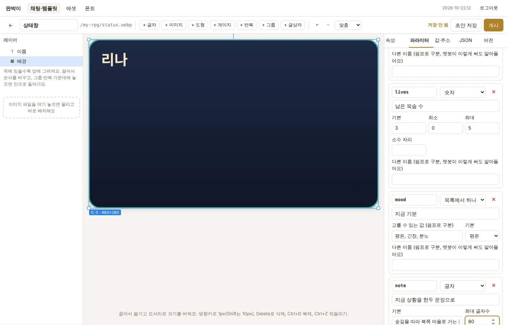

- **설명**은 꼭 채우세요. 나중에 복사하는 챗봇 안내문에 그대로 들어가서, 챗봇이 어떤 값을 넣어야 할지 알아요.
- 숫자는 **최소·최대** 밖의 값이 오면 그 끝값으로 잘라서 그려요. 빠지거나 이상한 값은 기본값으로 그려요.
- 글자는 **최대 글자수**를 넘는 부분이 조용히 잘려요(표시 없이 앞부분만 그려요). 따로 정하지 않으면 500자, 최대 2000자까지 늘릴 수 있어요.
  챗봇 안내문에 "최대 10자"가 함께 들어가니, 캐릭터 프롬프트의 글자 수 지시와 이 값을 맞춰 두면 돼요.
- **목록에서 하나**는 쉼표로 고를 수 있는 값을 적어요. 칸을 벗어나면 적용돼요.
- **다른 이름**에 `체력, HP`처럼 적어 두면 챗봇이 이름을 조금 다르게 써도 알아들어요.

## 6. 초상 이미지

레이어에서 **이름**을 고른 채 툴바의 **+ 이미지**를 누르면 그 바로 위에 이미지가 생겨요.
속성 탭의 **에셋** 칸에서 `portrait.svg`를 고르고, 이름을 `초상`, 위치 x 20, y 20, 크기 72×72로 맞춰요.

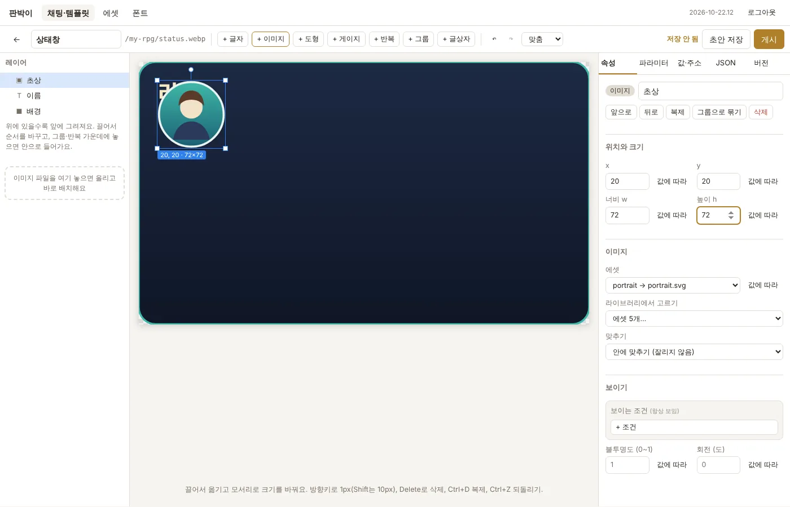

- **맞추기**는 기본이 "안에 맞추기"라 그림이 잘리지 않아요. 칸을 꽉 채우려면 "꽉 채우기"를 골라요.
- **에셋** 목록에는 이 템플릿이 이미 쓰는 그림이 먼저, 그 아래에 에셋 메뉴의 나머지 그림이 모두 나와요. 처음 고른 그림은 이 템플릿에 자동으로 추가돼요. **(없음)**을 고르면 비워져요.
- 위치 아래 **캔버스에 맞추기** 버튼으로 왼쪽·가운데·오른쪽, 위·가운데·아래에 바로 붙일 수 있어요.
- 템플릿은 그림을 **별명**으로 불러요. 오른쪽 **에셋** 탭에서 이 템플릿이 쓰는 그림과 폰트를 한곳에서 관리해요.

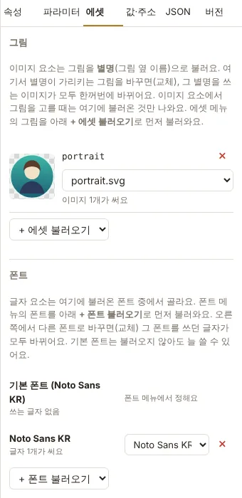

  - **그림**: 별명마다 미리보기, 가리키는 파일, 쓰는 이미지 수가 보여요. 파일을 바꾸면 그 별명을 쓰는 이미지가 모두 바뀌어요. **+ 그림 추가**로 미리 넣어 두거나, **안 쓰는 그림 빼기**로 정리해요.
  - **폰트**: 글자 요소가 쓰는 폰트와 글자 수가 보여요. 오른쪽에서 다른 폰트를 고르면 그 폰트를 쓰던 글자가 한꺼번에 바뀌어요.

## 7. 이름 글자와 넘침 처리

레이어에서 **이름**을 골라 x 108, y 18, 너비 250, 높이 34로 옮겨요. 내용 `{name}`은 그대로 둬요. 중괄호 안에 파라미터 이름을 쓰면 그 값이 들어가요.

이름이 길 때를 대비해 **글자가 너비(w)를 넘칠 때**를 정해요.

| 고르기 | 동작 |
|---|---|
| 그대로 두기 | 너비 밖으로 삐져나가요. |
| **글자 줄이기** | 실제 폰트 폭을 재서 너비에 맞게 글자를 줄여요. "가장 작은 크기"까지 줄여도 넘치면 나머지를 숨겨요. |
| 넘친 부분 숨기기 | 크기는 그대로 두고 너비 밖만 숨겨요. |

여기서는 **글자 줄이기**, 가장 작은 크기 14로 했어요. 너비(w)가 정해져 있어야 동작해요.


> 넘침 처리는 "칸에 맞게 보이는 방법"이고, 최대 글자수는 "받는 글자 수"예요. 둘은 따로 동작해요.

## 8. 체력 게이지

**+ 게이지**를 누르고 이름 `HP 게이지`, x 108, y 64, 크기 250×14로 맞춰요.
**현재 값**에서 `파라미터 hp`, **최대값**에서 `파라미터 maxhp`를 골라요. 게이지는 현재 값 ÷ 최대값만큼 차요(`hp=75`, `maxhp=150`이면 절반).

채움 색 옆의 **값에 따라**를 누르고 **숫자 구간에 따라**, `hp`를 고른 뒤 **+ 구간**으로 구간을 넣어요.

| 구간 | 색 |
|---|---|
| 60 이상 | `#4fbf5a` 초록 |
| 30 이상 | `#e6b93c` 노랑 |
| 그 밖 | `#e5484d` 빨강 |

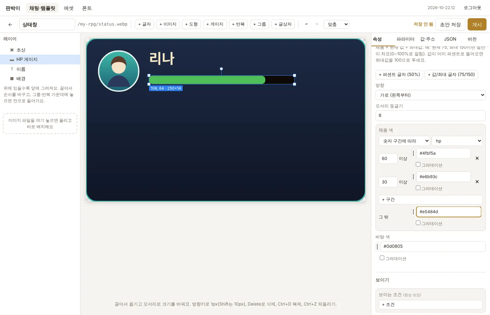

게이지 속성의 **+ 퍼센트 글자 (50%)**를 누르면 게이지 오른쪽에 `{hp|pct:maxhp}` 글자가 생겨요. 글자 크기를 14로 줄였어요.
**+ 값/최대 글자**를 누르면 `80/100`처럼 나와요.

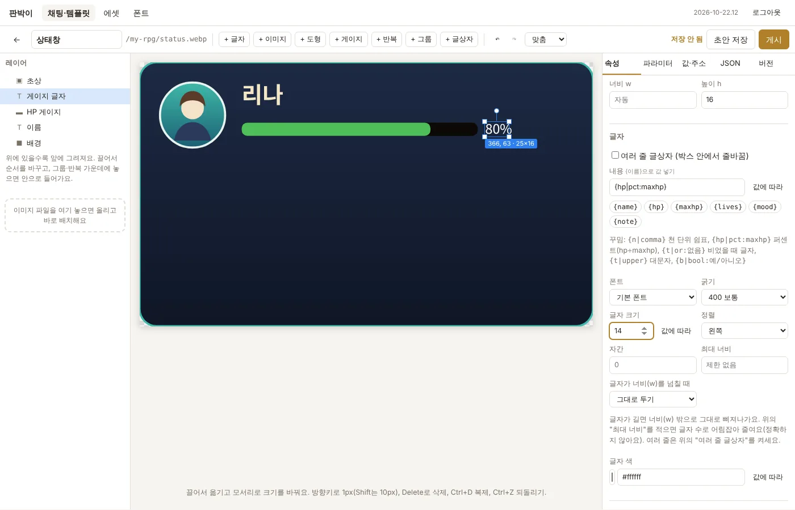

> 글자 안에서 값을 꾸미는 법: `{n|comma}` 천 단위 쉼표, `{hp|pct:maxhp}` 퍼센트, `{t|or:없음}` 비었을 때 글자, `{b|bool:예/아니오}`.

## 9. 반복: 목숨 하트

**+ 반복**을 누르면 동그라미 3개가 나란히 생겨요. 반복은 안에 든 요소를 정한 개수만큼 간격을 두고 되풀이해요.

1. 반복 요소 이름을 `목숨`, 위치 x 108, y 88로 해요.
2. **개수**에서 `파라미터 lives`, 가로 간격 dx 26, 최대 개수 5.
3. 레이어에서 반복 안의 동그라미를 골라 Delete로 지워요.
4. **목숨**을 고른 채 **+ 이미지**를 누르면 반복 안에 이미지가 들어가요. `heart.svg`를 고르고 22×22로 맞춰요.

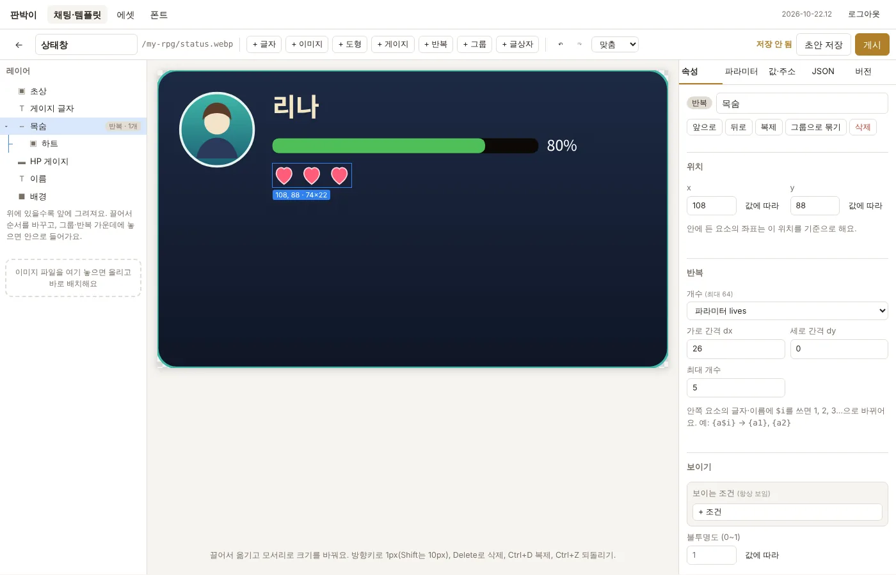

- 반복 안 요소의 좌표는 반복 위치를 기준으로 해요(0, 0이 반복의 왼쪽 위).
- 안쪽 글자에 `$i`를 쓰면 1, 2, 3…으로 바뀌어요. 예: `{p$i}` → `{p1}`, `{p2}`. 파티원 목록 같은 데 써요.
- 레이어 줄을 반복 줄 가운데에 끌어다 놓아도 안으로 들어가요.

## 10. 값에 따라 고르기: 기분 색

**+ 글자**로 `기분` 글자를 만들고 내용 `{mood}`, x 380, y 22, 너비 80, 글자 크기 16, 정렬 오른쪽으로 해요.
글자 색 옆 **값에 따라**를 누르면 "값에 따라 고르기"가 돼요. 파라미터를 `mood`로 바꾸고 **모두 추가**를 누르면 평온·긴장·분노 줄이 생겨요. 각각 색을 넣어요.

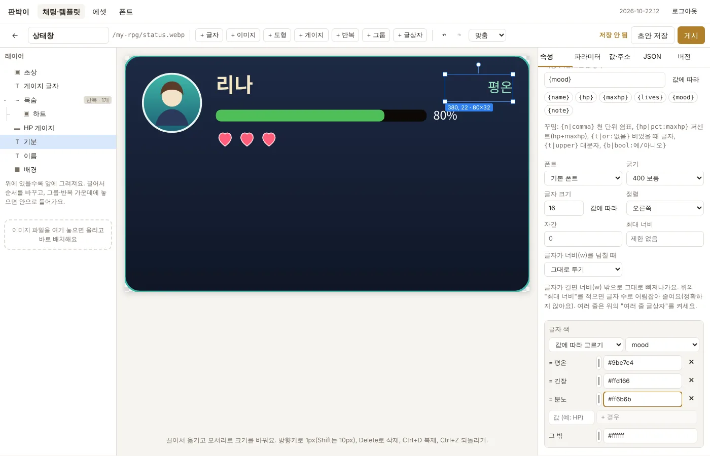

"값에 따라"는 위치, 크기, 색, 글자, 에셋 등 대부분의 칸에 있어요.

### 값마다 다른 그림

기분마다 다른 그림을 보여 주고 싶다면, 먼저 쓸 그림들을 에셋 메뉴에 모두 올려 둬요(예: `calm.svg`, `tense.svg`, `angry.svg`). 그다음 이미지 요소의 **에셋** 옆 **값에 따라**를 누르고, 파라미터를 `mood`로 바꾼 뒤 **모두 추가**를 눌러요. 평온·긴장·분노 줄마다 오른쪽 목록에서 그림을 골라요.

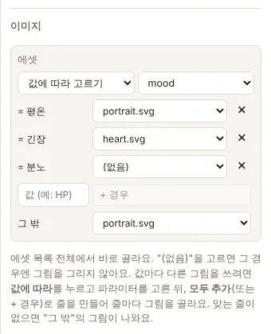

- 목록에는 에셋 메뉴의 모든 그림이 나와서, 여기서 바로 고르면 돼요. 따로 불러올 필요가 없어요.
- **(없음)**을 고르면 그 값일 때 그림을 그리지 않아요. 줄을 아예 빼려면 오른쪽 ✕를 눌러요.
- 맞는 줄이 없으면 **그 밖** 그림이 나와요.

## 11. 보이는 조건: 위험 표시

체력이 낮을 때만 `위험!`이 보이게 해 볼게요. **+ 글자**로 내용 `위험!`, 빨간 글자를 만들고, 속성 맨 아래 **보이기 → + 조건**에서 `hp` `<` `30`을 넣어요.

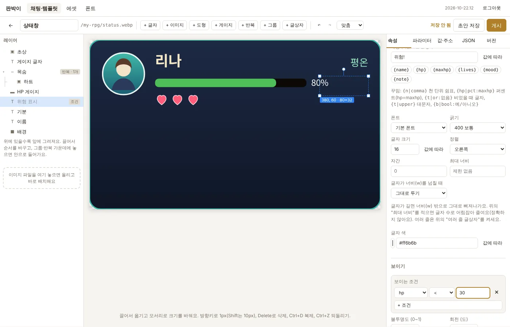

조건이 있는 요소는 레이어에 **조건** 표시가 붙고, 지금 미리보기 값으로 안 보이면 흐리게 나와요. 조건을 여러 개 넣으면 "모두 맞을 때 / 하나라도 맞을 때"를 고를 수 있어요.

## 12. 여러 줄 글상자: 지금 상황

긴 글은 **+ 글상자**로 넣어요. 박스 너비에서 띄어쓰기마다 줄이 바뀌어요.
이름 `상황`, 내용 `{note}`, x 20, y 128, 크기 440×128, 글자 크기 18로 맞추고, **글자가 박스를 넘칠 때**를 **글자 줄이기**(가장 작은 크기 12)로 해요.
줄이 높이(h)에 다 들어갈 때까지 글자가 작아져요.

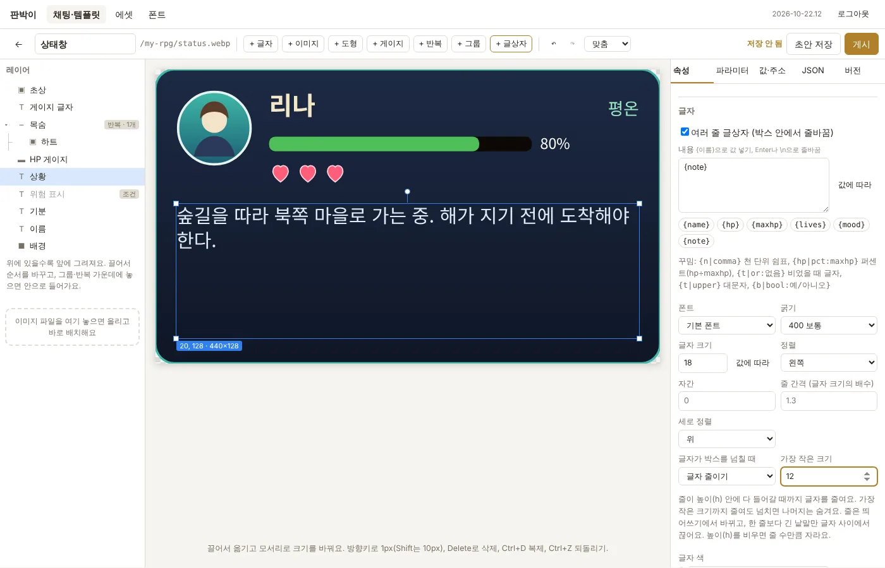

- 내용 칸에서 Enter를 치거나 챗봇이 값 안에 `\n`을 쓰면 그 자리에서 줄이 바뀌어요.
- 줄 간격과 세로 정렬(위/가운데/아래)도 고를 수 있어요.

마지막으로 **+ 도형**에서 모양을 **선**으로 바꿔 x 20, y 116, 너비 440, 높이 0인 구분선을 넣고 **초안 저장**(Ctrl+S)을 눌러요.
초안 저장은 서버에 보관만 하고, 이미지 주소에는 아직 반영되지 않아요.

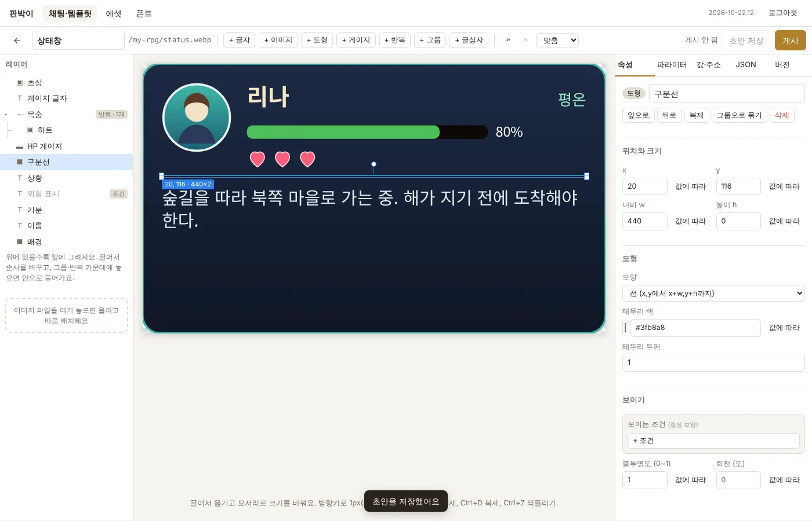

## 13. 여러 값으로 시험하기

**값·주소** 탭의 **미리보기 값**을 바꾸면 가운데 그림이 바로 바뀌어요. 서버를 쓰지 않으니 마음껏 바꿔 보세요.
긴 이름, 낮은 체력, 긴 상황 글을 넣어 넘침 처리와 조건이 잘 되는지 봐요.

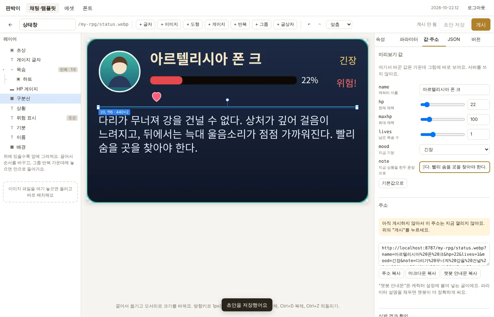

이름 칸에 `아르텔리시아 폰 크로이츠`(13자)를 넣었지만 최대 글자수가 10이라 `아르텔리시아 폰 크`까지만 들어갔어요. 실제 주소로 와도 똑같이 잘려요.
글자 수가 부족하면 파라미터의 최대 글자수를 늘리고 프롬프트도 같이 고쳐요.

**서버로 렌더**를 누르면 실제 서버가 그린 그림을 보여 줘요(저장은 안 해요). 브라우저 미리보기는 글자 위치가 1~2px 다를 수 있어서, 마지막 확인용으로만 가끔 눌러요. 무료 플랜 CPU를 써요.

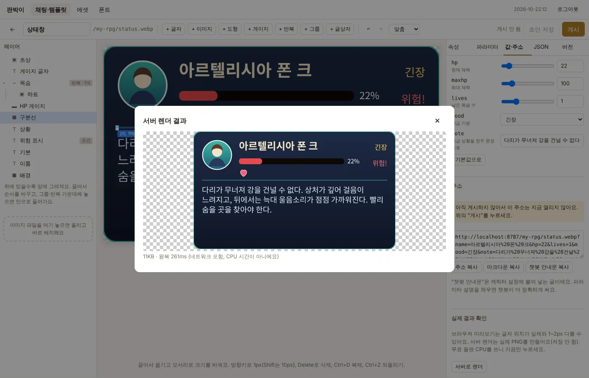

## 14. 게시하고 주소 복사하기

오른쪽 위 **게시**를 누르면 v1로 게시돼요. 이제 이미지 주소가 열려요.

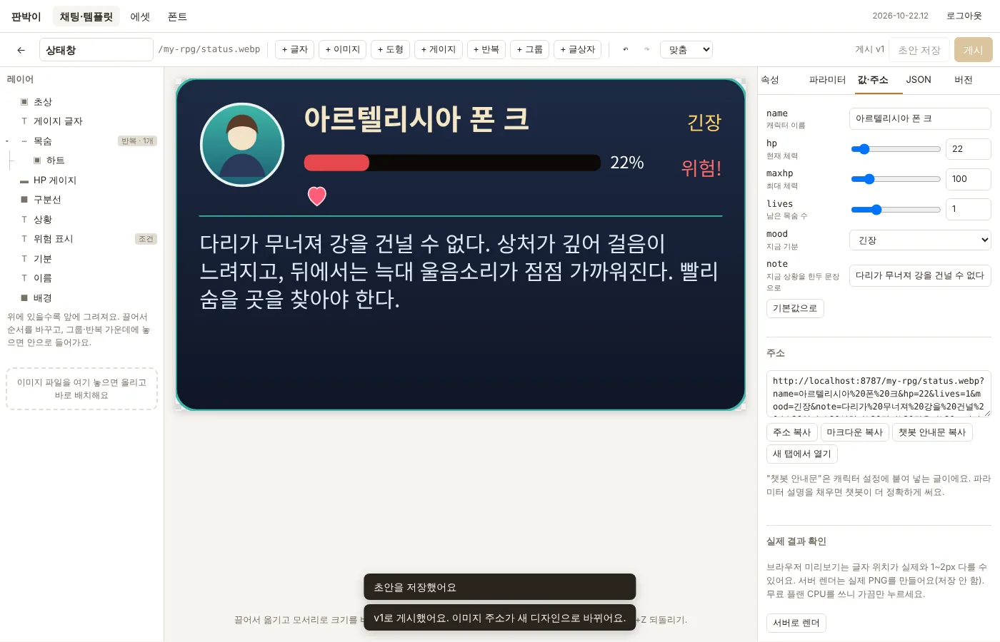

값·주소 탭의 버튼:

- **주소 복사**: 지금 미리보기 값으로 만든 이미지 주소(`.webp`).
- **마크다운 복사**: `` 형태. 채팅에 바로 붙여 그림으로 보여요.
- **챗봇 안내문 복사**: 캐릭터 설정(프롬프트)에 붙여 넣는 글이에요.

이 예제의 챗봇 안내문은 이렇게 복사돼요.

```
[상태창 이미지]
매 답변 끝에 현재 상태를 아래 형식의 이미지 한 줄로 출력하세요. 주소는 바꾸지 말고 ? 뒤의 값만 채웁니다.

- name: 캐릭터 이름. 글자, 최대 10자
- hp: 현재 체력. 숫자 0~999
- maxhp: 최대 체력. 숫자 0~999
- lives: 남은 목숨 수. 숫자 0~5
- mood: 지금 기분. 평온, 긴장, 분노 중 하나
- note: 지금 상황을 한두 문장으로. 글자, 최대 80자
값을 모르면 그 항목은 빼도 됩니다(기본값으로 그려짐). 글자 값의 공백은 %20으로 씁니다.
예시: 
```

챗봇이 이렇게 쓰면 오른쪽 그림이 나와요.

```

```

 

## 15. 고치고 다시 게시하기

- 고친 뒤 다시 **게시**하면 v2, v3…로 쌓이고, 같은 주소가 새 디자인으로 그려져요.
- 주소 뒤에 `@1`을 붙이면(`status@1.webp`) 그 버전으로 고정돼요.
- **버전** 탭에서 예전 버전을 불러오거나 이미지 주소를 예전 버전으로 되돌릴 수 있어요.
- 이미 채팅에 뜬 이미지는 브라우저 캐시 때문에 저장본 수명(기본 6시간)까지 예전 모양일 수 있어요.
- 다른 채팅에서 비슷한 템플릿을 만들 때는 템플릿 추가의 "복사: …"로 시작하거나, zip으로 내보내고 가져와요.

## 16. 무작위: 주사위 굴리기

챗봇이 "주사위를 굴렸더니 6!"이라고 직접 정하면, 결과를 먼저 생각하고 숫자를 고르기 쉬워요. **무작위** 파라미터는 숫자를 판박이가 굴려요.

1. 파라미터 탭에서 `turn`을 **숫자**로 만들고 설명을 `턴 번호 (매 응답마다 1씩 올려요)`로 적어요.
2. `dice`를 만들고 종류를 **무작위 (주사위)**로 바꿔요. 굴리는 방식은 **숫자 범위**, 최소 1, 최대 6.
3. **+ 글자**로 내용 `주사위 {dice}`를 넣어요.

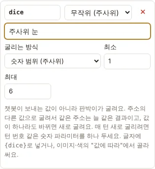

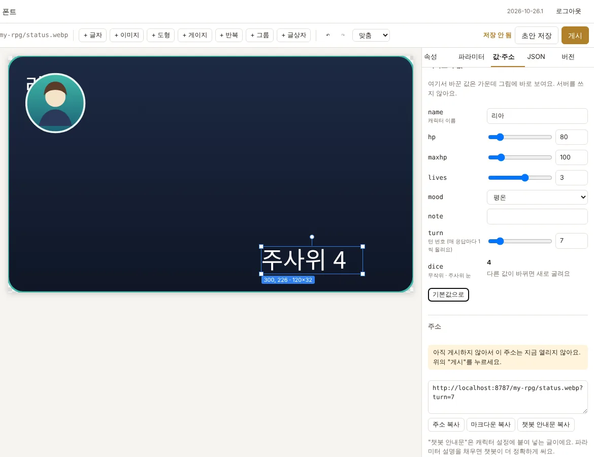

- 무작위 값은 주소에 넣지 않아요. 주소의 다른 값들로 굴리기 때문에 **같은 주소는 늘 같은 결과**예요. 다시 열어도, 다른 사람이 봐도 같아요.
- 값이 하나라도 바뀌면 새로 굴려요. 그래서 `turn`처럼 매번 바뀌는 숫자를 하나 두면 턴마다 새 결과가 나와요.
- **목록에서 하나 뽑기**를 고르면 `대길, 길, 흉`처럼 적어 둔 값 중 하나를 뽑아요. 뽑은 값은 "값에 따라"에서도 쓸 수 있어서, 결과마다 다른 그림이나 색을 고를 수 있어요.
- 값·주소 탭에서 다른 값을 바꿔 보면 굴린 결과가 어떻게 바뀌는지 바로 보여요.

## 자주 막히는 곳

- 한글이 네모로 나와요 → 폰트 메뉴에 한글 폰트가 있는지 봐요(1장).
- 게이지가 비어 있어요 → 값·주소 탭의 미리보기 값을 보세요. 현재 값 파라미터가 0이거나 최대값이 너무 크면 비어 보여요.
- 글자 줄이기가 안 돼요 → 너비(w)를 비워 두면 동작하지 않아요. 숫자를 넣어요.
- 편집하다 뒤로 가기를 눌렀어요 → 저장하지 않은 변경이 있으면 나갈지 먼저 물어봐요. **초안 저장**을 누르고 나가요.
- 주소를 열면 "없는 페이지"예요 → 아직 게시하지 않았어요. **게시**를 눌러요.
- 챗봇이 값을 이상하게 넣어요 → 파라미터 **설명**과 **다른 이름**을 채우고 챗봇 안내문을 다시 복사해 붙여요.
